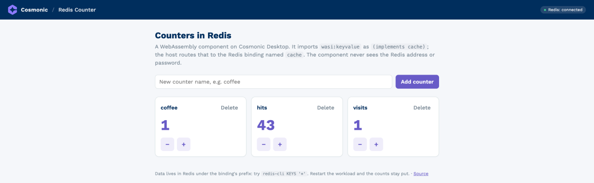

# Redis Counter for Cosmonic Desktop

A small WebAssembly component that keeps counters in **Redis**, using
[wasmCloud's Redis keyvalue backend](https://wasmcloud.com/docs/kubernetes-operator/host-interface-configuration/)
as configured in [Cosmonic Desktop](https://cosmonic.com).



The component imports `wasi:keyvalue/store` under the label `cache`:

```wit
world redis-counter {
    import cache: wasi:keyvalue/store@0.2.0-draft;
    export wasi:http/incoming-handler@0.2.2;
}
```

Cosmonic Desktop routes that import to the **Redis binding named `cache`**
(Settings → Built-in plugins → Redis). The binding holds the Redis URL and
password. The workload only names it, and the component never sees either.

## Run it

You need Cosmonic Desktop with Redis/S3 bindings (0.5.33 or newer), Docker,
Rust with the `wasm32-wasip2` target, and [`wash`](https://wasmcloud.com/docs/installation).

1. **Start Redis** (loopback only, no persistence):

   ```sh
   scripts/start-redis.sh          # redis://127.0.0.1:6379
   ```

2. **Add the binding** in Cosmonic Desktop: Settings → Built-in plugins →
   Redis → *Add binding*.
   - Binding name: `cache`
   - URL: `redis://127.0.0.1:6379`
   - Key prefix: `demo:` (optional)
   - Password: leave empty for this local Redis

   Then click **Restart host**. Bindings are read when the host starts.

3. **Build and push** the component to Desktop's built-in registry:

   ```sh
   scripts/build.sh                # -> oci.localhost:8200/apps/desktop-redis-counter:0.2.0
   ```

4. **Deploy** `workload.yaml`: paste it into Workloads, or ask your coding
   agent to apply it with the Cosmonic MCP tools.

5. **Open <http://redis-counter.localhost:8200/>.** Add counters and click
   **+** / **−**. Then look in Redis:

   ```sh
   redis-cli KEYS '*'              # demo:coffee, ...
   ```

   Restart the workload and the counts are still there.

## API

| Method | Path | |
| --- | --- | --- |
| `GET` | `/api/counters` | `{"counters":[{"name","value"}]}` |
| `POST` | `/api/counters/<name>/increment` | +1; creates the counter at 1 |
| `POST` | `/api/counters/<name>/decrement` | −1, never below 0 |
| `DELETE` | `/api/counters/<name>` | remove the counter |

## What the host enforces

The workload names only the binding:

```yaml
- namespace: wasi
  package: keyvalue
  interfaces: [store]
  name: cache
```

Cosmonic Desktop refuses a manifest that sets the Redis `url`, `prefix` or
connection settings itself. It also refuses one that names a binding the host
doesn't declare.

## Notes

- **`scripts/build.sh` needs `wasm-component-ld` 0.5.30 or newer.** The linker
  bundled with older Rust toolchains rejects `(implements ..)` import names
  (`invalid leading byte (0x2) for import name`). The script installs a newer
  one with `cargo install` if none is on your `PATH`.
- **Stop Redis** with `scripts/stop-redis.sh`.

## License

Apache-2.0
